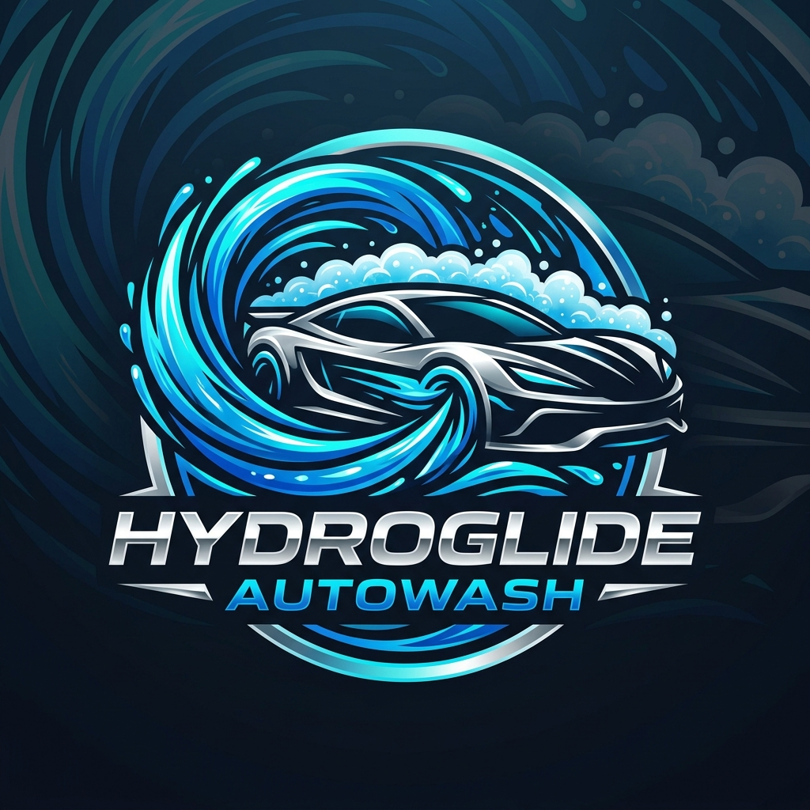
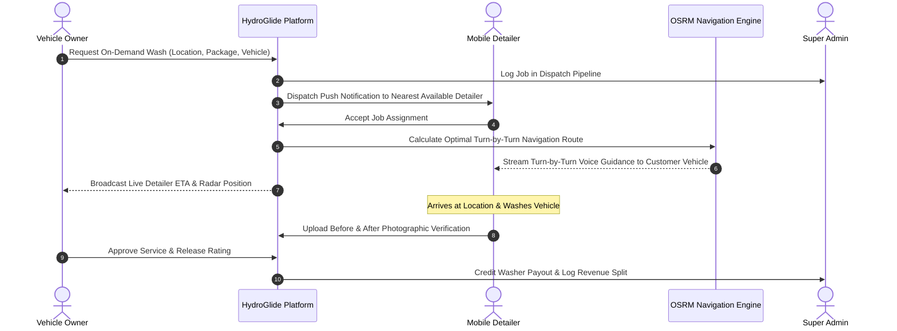

<div align="center">

<p align="center">
  
</p>

# HydroGlide AutoWash

### On-Demand Mobile Auto Detailing, Fleet Dispatch & Live Navigation Ecosystem

[](https://flutter.dev)
[](https://dart.dev)
[](https://firebase.google.com)
[](https://project-osrm.org)
[](https://stripe.com)
[](LICENSE)

<p align="center">
  <b>HydroGlide</b> is a full-featured on-demand vehicle care and mobile detailing platform. Featuring automated washer dispatch, OpenStreetMap (OSRM) turn-by-turn voice navigation, live GPS fleet radar, multi-tier wash packages, and a comprehensive super-admin revenue management portal.
</p>

</div>

---

## 🌟 Platform Architecture & User Roles

HydroGlide orchestrates the entire auto detailing lifecycle across four distinct user roles within a unified cross-platform application:

```mermaid
graph TD
    subgraph HydroGlide Platform
        direction TB
        App[HydroGlide Cross-Platform Client]
        App --> C[Customer Role]
        App --> E[Mobile Detailer / Driver Role]
        App --> S[Station Manager Role]
        App --> A[Company Super Admin Role]
    end

    subgraph Customer Experience
        C --> C1[On-Demand & Scheduled Wash Booking]
        C --> C2[Vehicle Fleet Profile Management]
        C --> C3[Live Detailer Radar & Map Tracking]
        C --> C4[Direct In-App Chat & Help Desk]
        C --> C5[Digital Payments & Service Invoicing]
    end

    subgraph Detailer Fleet Operations
        E --> E1[Job Dispatch Queue & Acceptance]
        E --> E2[OSRM Turn-by-Turn Voice Navigation]
        E --> E3[Before & After Photo Proof Upload]
        E --> E4[Performance Metrics & Daily Payouts]
    end

    subgraph Administration & Governance
        S --> S1[Physical Station Queue Management]
        A --> A1[Global Fleet Radar & Live Map]
        A --> A2[Revenue, P&L & Commission Analytics]
        A --> A3[Complaint & Dispute Resolution]
    end
```



---

## 🗺️ Live Dispatch & Navigation Flow



---

## ✨ Core Capabilities

### 🚗 1. Customer Experience
- **Smart Booking Flow:** Select mobile driveway service or reserve a physical station bay with precision time slots.
- **Vehicle Garage:** Store multiple vehicles with make, model, color, license plate, and specific detailing preferences.
- **Live Radar:** Real-time visual tracking of assigned detailer van en route with arrival countdown.
- **In-App Communication:** Seamless messaging channel between client and field detailer.

### 🧽 2. Field Detailer & Driver Suite
- **Turn-by-Turn Audio Navigation:** Built-in OpenStreetMap routing with real-time speech synthesized navigation guidance.
- **Job Proof Verification:** Integrated camera workflow capturing before-and-after work snapshots before completion.
- **Shift & Earnings Tracker:** Real-time visibility into completed jobs, tips, and daily withdrawal balances.

### 🏢 3. Station Management & Super Admin
- **Physical Station Discovery:** Map overview of all physical branch locations, operating hours, and bay occupancy.
- **Super Admin Command Center:** Global overview of total fleet revenue, active bookings, user disputes, and complaints.
- **Granular Role-Based Access Control:** Secure gating between Customers, Technicians, Managers, and Super Administrators.

---

## 📁 Repository Structure

```
HydroGlide-AutoWash/
├── assets/
│   └── branding/
│       └── logo.png               # Official brand identity
├── cpanel_public_html/            # Web management & landing assets
├── functions/                     # Firebase Cloud Functions (Dispatch queue, FCM notifications)
├── lib/
│   ├── main.dart                  # Application entry point & service providers
│   ├── firebase_options.dart      # Multi-platform Firebase configuration
│   ├── models/                    # Data models (Booking, Station, Vehicle, User, Invoice)
│   ├── providers/                 # State management (Auth, Booking, Theme, Navigation)
│   ├── screens/
│   │   ├── admin/                 # Branch manager dashboard & scheduling
│   │   ├── auth/                  # Multi-role authentication & role switcher
│   │   ├── booking/               # Map pin location picker & slot reservation
│   │   ├── customer/              # Customer dashboard, vehicle garage, complaint filing
│   │   ├── employee/              # Mobile detailer dashboard & OSRM voice navigation
│   │   ├── station/               # Station discovery map & bay status
│   │   └── super_admin/           # Master revenue, stations, and complaints dashboard
│   ├── services/
│   │   ├── navigation/            # OSRM routing engine & voice guidance
│   │   ├── booking_service.dart   # Dispatch lifecycle & reservation logic
│   │   └── chat_service.dart      # Real-time customer-to-technician messaging
│   ├── theme/                     # Dark mode & automotive color tokens
│   └── widgets/                   # Turn-by-turn overlay, queue sheets, app buttons
├── test/                          # Unit and integration test suites
├── firestore.rules                # Granular role-based Firestore security
└── README.md
```

---

## 🚀 Getting Started

### Prerequisites
- **Flutter SDK:** `>= 3.9.0`
- **Firebase Project:** (Firestore, Auth, Storage, Cloud Messaging)
- **OSRM Server:** (Public endpoint or self-hosted OpenStreetMap server)

### Quick Start
```bash
# Clone the repository
git clone https://github.com/itismemuhammadali/HydroGlide-AutoWash.git
cd HydroGlide-AutoWash

# Install dependencies
flutter pub get

# Launch on connected mobile device or simulator
flutter run
```

---

## 🔒 Confidentiality & White-Label Notice
This repository is an open-source demonstration and portfolio showcase. All proprietary client data, commercial vendor contracts, live API tokens, and client credentials have been sanitized and decoupled.

---

## 👨‍💻 Author
**Muhammad Ali**
- GitHub: [@itismemuhammadali](https://github.com/itismemuhammadali)
- Portfolio & Engineering Showcase
